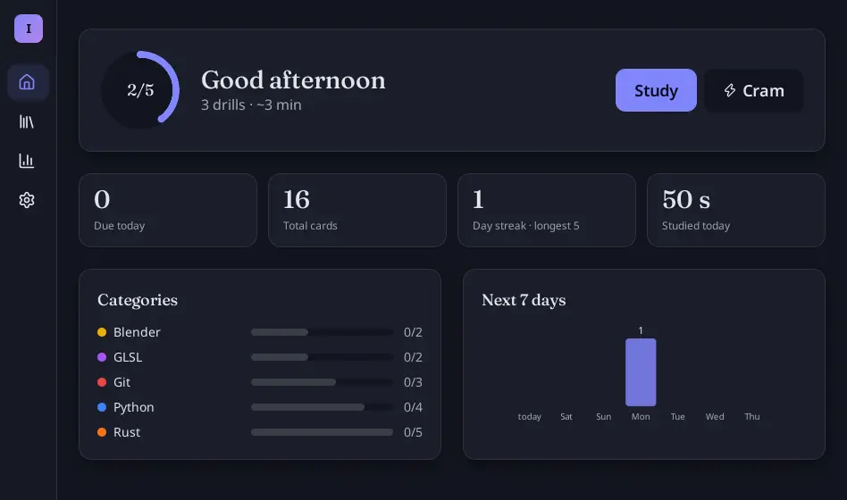
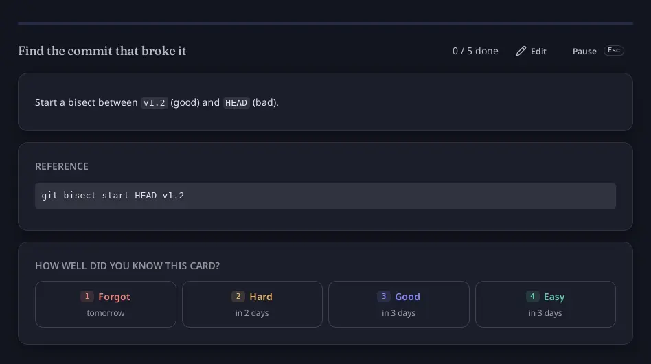
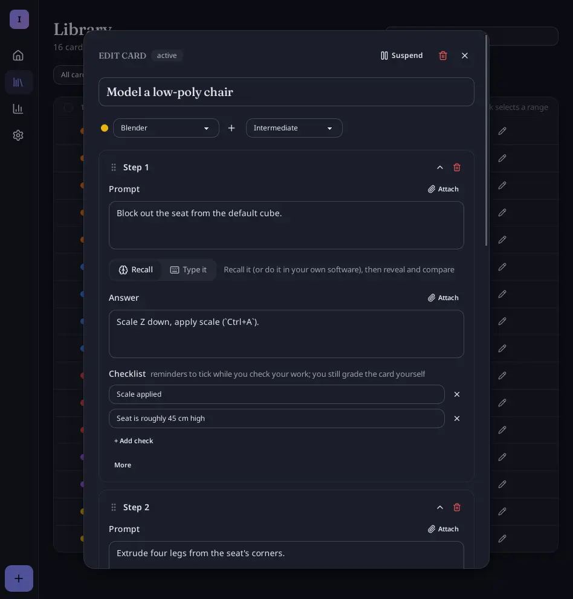
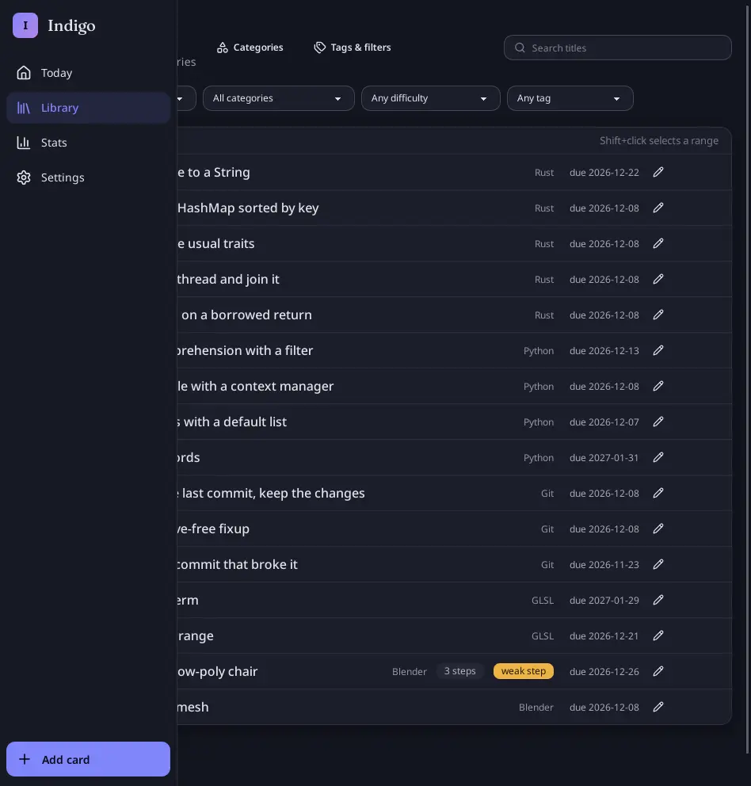
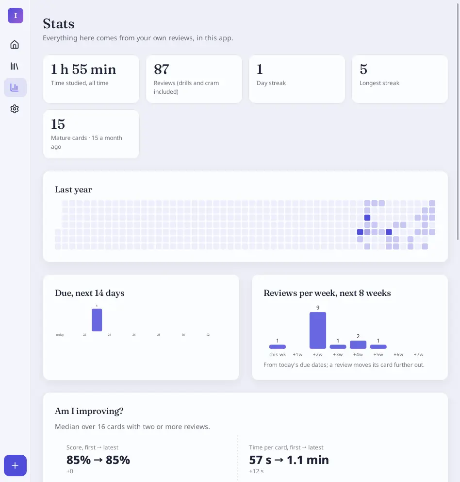
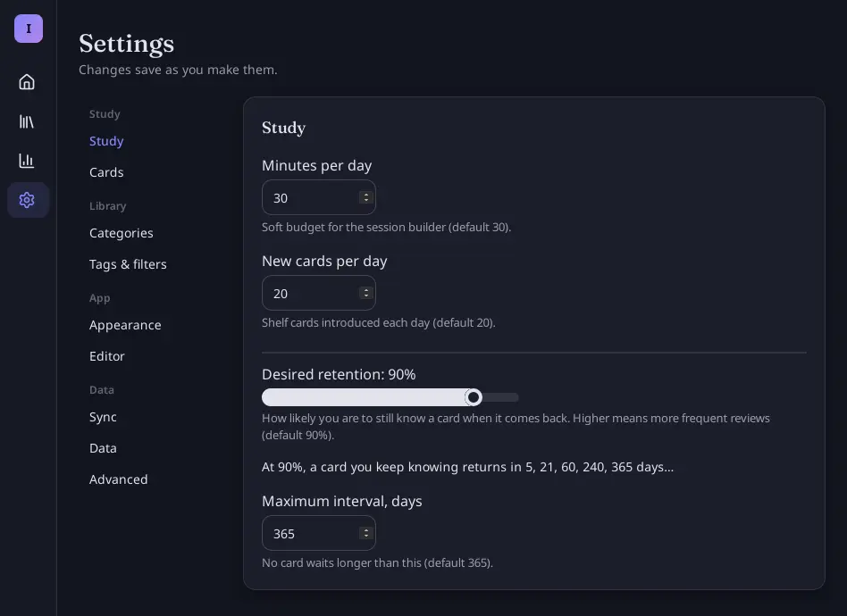

<p align="center">
  
</p>

<p align="center">
  <b>Author:</b> Regan O'Donnell &nbsp;·&nbsp; <b>Released:</b> November 20, 2026 &nbsp;·&nbsp; <b>License:</b> MIT
</p>

<p align="center">
  
</p>

## What is this

Indigo is an app I made to help life long learners hold on to what they learn, easier and for longer. I originally made it to help me memorize code, since I kept looking up the same snippets over and over again.

It's a flash card app at heart, but built around actually doing the thing instead of just flipping a card over.

* A card can be one quick question, or a multi-step exercise you do in your own software, i.e. model a chair in Blender in three steps
* Answer from memory (**Recall**) or type the code out (**Type it**) and compare it against the answer
* You grade every card yourself, once, at the end. Nothing grades for you
* Scheduling is done by [FSRS](https://github.com/open-spaced-repetition/fsrs4anki/wiki/The-Algorithm), the same algorithm Anki uses, so cards come back right before you'd forget them
* Code is syntax highlighted for ~80 languages
* It works offline, and syncs between your computers through a private GitHub repo you own

If you've enjoyed using this tool, please star this repo!

## Download

Grab the latest release here: **[Releases](https://github.com/1sun12/study-app-fsrs-indigo/releases/latest)**

| OS | File |
|---|---|
| Mac (Apple Silicon and Intel) | `Indigo_0.3.0_universal.dmg` |
| Windows 10 / 11 | `Indigo_0.3.0_x64-setup.exe` (or the `.msi`) |
| Linux | `Indigo_0.3.0_amd64.AppImage`, `.deb` or `.rpm` |

Linux is where I use it every day. The Mac and Windows builds come out of the same code, but I haven't put real hours into them yet, so let me know if something's off.

## Installing

1. Go here: **[Releases](https://github.com/1sun12/study-app-fsrs-indigo/releases/latest)** and download the file for your OS (see [Download](#download))

The app isn't signed with a paid Apple or Microsoft certificate, so your OS will warn you the first time. That's expected; here's how to get past it on each one.

### Mac

1. Open the `.dmg` and drag **Indigo** into **Applications**
2. Open Indigo. macOS will say it can't verify the developer
3. Go to **System Settings → Privacy & Security**, scroll down and click **Open Anyway**
4. If macOS says the app "is damaged and can't be opened", run this once in Terminal, then open it again:

```bash
xattr -cr /Applications/Indigo.app
```

### Windows

1. Run `Indigo_0.3.0_x64-setup.exe`
2. If you get **"Windows protected your PC"** (SmartScreen), click **More info → Run anyway**
3. Indigo shows up in the Start menu when it's done

### Linux

AppImage (works on most distros, nothing to install):

```bash
chmod +x Indigo_0.3.0_amd64.AppImage
./Indigo_0.3.0_amd64.AppImage
```

* If it won't start on Ubuntu 22.04 or newer, it needs FUSE 2: `sudo apt install libfuse2` (on 24.04 the package is `libfuse2t64`)

Debian / Ubuntu / Pop!_OS:

```bash
sudo apt install ./Indigo_0.3.0_amd64.deb
```

Fedora / RHEL:

```bash
sudo dnf install ./Indigo-0.3.0-1.x86_64.rpm
```

### Linux, the install script (what I use)

This builds Indigo from source on your machine and sets everything up for you: the packages it needs (including `ffmpeg` and `git`), Rust and Node if you don't have them, the app menu entry, and optionally sync.

```bash
git clone https://github.com/1sun12/study-app-fsrs-indigo.git indigo
cd indigo
./install.sh
```

* Works on Debian, Ubuntu, Pop!_OS, Mint, Arch and its relatives, Fedora and Void
* The first build takes a few minutes
* Run `./install.sh` again any time to update. It pulls the latest, closes Indigo if it's open (after syncing), and never touches your cards
* `./uninstall.sh` removes everything it installed. It won't delete your cards unless they're safely synced
* More options are in [docs/INSTALL.md](docs/INSTALL.md)

### Optional extras

* **`ffmpeg`** shrinks videos and audio when you attach them. Without it they're stored as is
* **`git`** is needed for sync:
  * Mac: `xcode-select --install`
  * Windows: [Git for Windows](https://git-scm.com/download/win)
  * Linux: `sudo apt install git` (or your distro's equivalent)

### Blocked by a firewall or antivirus?

* Indigo never listens on your network. It serves its own images and videos to itself on `127.0.0.1` only, so if a firewall asks, you can deny it
* The only thing that goes online is **sync**, which uses `git` to reach GitHub over HTTPS (port 443) or SSH (port 22)
* If your network blocks port 22 (common on work and school networks), use the HTTPS link for your sync repo instead of the `git@github.com:` one
* If antivirus quarantines the installer, restore it and add an exception. It's flagged only because it's unsigned; the source is all here

## How to use it

### Today

* The home screen shows what's due, your streak, how far along each category is, and what's coming up over the next 7 days
* Click **Study** to work through everything due today. It fits inside your daily time budget (30 minutes by default)
* Click **Cram** to practise any cards you want without moving their due dates
* If you stop in the middle of a card, it shows up under **Continue** next time so you can resume, restart or toss it

### Studying



* Read the prompt, answer it in your head (or in Blender, or your editor, whatever the card is about), then press `Enter` to reveal the answer
* For **Type it** cards, type your answer and press `Ctrl+Enter`. Flip on **Show diff** to see exactly what you got wrong
* Multi-step cards go one step at a time. Checklists are just reminders of what to look for, they never decide the grade
* Grade the whole card at the end: **Forgot**, **Hard**, **Good** or **Easy** (or `1`–`4`)
* Every grade button shows when you'll see the card again, so there are no surprises
* Steps you keep missing get flagged as weak and come back as short drills
* `Esc` pauses. You can pick it back up later, and the timer only counts time you actually spent on it

### Adding a card



* Click the **+** at the bottom left
* Give it a title, a category and a difficulty, then fill in the prompt and the answer. Both are Markdown
* Add more steps for longer exercises, and drag them to reorder
* Paste images straight in with `Ctrl+V`, or attach images, GIFs, video and audio
* `Ctrl+Enter` saves, `Ctrl+Shift+Enter` saves and starts the next card with the same category and settings
* Turn on **Vim** in **Settings → Editor** if that's your thing

### Library



* Every card you've made, with filters for state, category, difficulty and tag, plus a title search
* Click the pencil on any row to edit it
* Click to select, `Shift+click` to select a range. Then cram them, suspend them, move them to another category, change their difficulty, export them or delete them
* Categories and tags are all yours, nothing is made for you. Manage them in **Settings → Categories** and **Settings → Tags & filters**, where you can also save filters you use a lot

### Stats



* Total time studied, reviews, current and longest streak
* A GitHub style heat map of the last year
* What's due over the next two weeks and the next two months
* **Am I improving?** compares your first attempts to your latest ones, both score and speed
* Time per card, your grade mix, and the steps that keep tripping you up

### Settings



* **Study**: minutes per day, new cards per day, and how much you want to remember (40% to 99%, default 90%). It shows you live how far apart reviews get at that number
* **Cards**: size limits for attachments
* **Appearance**: Light, Dark or follow your system, and **Minimal UI** to hide the helper text
* **Editor**: Vim keybindings on or off
* **Sync** and **Data** (below)

### Syncing between computers

1. Create an **empty, private** repo on GitHub, i.e. `indigo-vault`
2. Paste its link in **Settings → Sync** and click **Sync now**
3. Do the same on your other computer with the same link

* It uses your computer's own `git` login (GitHub CLI, SSH key or credential manager), so the app never sees or stores a password. The easiest way is `gh auth login` then `gh auth setup-git`
* It syncs when Indigo opens, after each study session, when you click **Sync now**, and when you close it
* Your actual database never leaves your computer. Indigo writes your cards out as small files and pushes those
* Videos and audio get compressed when you attach them, since git keeps every file forever. Nothing over 95 MB gets stored
* The full guide, including what to do when something goes wrong, is in [docs/SYNC.md](docs/SYNC.md)

### Backups and sharing

* **Settings → Data → Export backup** saves everything into one zip. Importing a backup merges it in, it never wipes what you have
* Select cards in the Library and click **Export** to make an `.indigopack` you can send to anyone. It has the cards and their media, but none of your history
* **Import pack** in **Settings → Data** adds a pack's cards to your library

## Keyboard shortcuts

* `?` show all of these in the app
* `Enter` reveal the answer, or go to the next card
* `Ctrl+Enter` submit a typed answer, or save in the card editor
* `Ctrl+Shift+Enter` save and start the next card
* `1` `2` `3` `4` Forgot, Hard, Good, Easy
* `Space` tick the focused checklist item
* `Esc` pause the session, or close the card editor

On a Mac, use `Cmd` instead of `Ctrl`.

## FAQ

**Where is my data stored?**

* Mac: `~/Library/Application Support/app.indigo.desktop/`
* Windows: `%APPDATA%\app.indigo.desktop\`
* Linux: `~/.local/share/app.indigo.desktop/`
* Your cards and reviews are a single SQLite file, `indigo.sqlite`, and images and videos are in the `vault` folder next to it. Indigo also backs up the database on its own before upgrades and sync merges

**Do I need the internet?**

* No. Everything works offline. Only sync goes online, and if you're offline it just waits quietly until you're back

**What happens if I edit the same card on two computers?**

* The newer edit wins, and the other one is kept under **Settings → Sync → Conflicts** where you can restore it. Nothing is lost

**Does it watch my screen or what I do in other apps?**

* No. Indigo only knows what happens in its own window. No hotkeys, no screen capture, no clipboard watching, no timing of what you do elsewhere. Pasting an image only reads the clipboard when you press `Ctrl+V`

**Is there AI in it?**

* No. You make the cards and you grade them. That's the whole point

**Why does "Good" sometimes bring a card back in 3 days and sometimes in 2 months?**

* That's FSRS. Every review tells it how well you know that card, so the ones you're solid on drift further and further apart

**Why GitHub for sync instead of an account?**

* No server to run, no account to make, free, private, and you get the full history of your cards as a bonus

**Does the theme sync?**

* No. Theme, Vim mode, saved filters and the sync link are per computer. Cards, categories, reviews and media sync

## Building from source

You'll need [Node.js](https://nodejs.org) 22+, [Rust](https://rustup.rs), and the [Tauri prerequisites](https://tauri.app/start/prerequisites/) for your OS.

```bash
git clone https://github.com/1sun12/study-app-fsrs-indigo.git
cd study-app-fsrs-indigo
npm ci
npm run tauri dev
```

* `npm run tauri build` makes the installers for whatever OS you're on
* Pushing a `v*` tag builds Mac, Windows and Linux in GitHub Actions and drafts a release

Tests:

```bash
cargo test --workspace                            # core and backend, including the scheduling simulation
npm run check && npm run lint && npm run test     # front end
cargo run -p indigo-core --bin sim -- --help      # try out the scheduler from the command line
```

## Tech stack

* Made with [Tauri 2](https://tauri.app), so it's a small native app instead of a bundled browser
* Rust backend, with all the real logic in its own fully tested crate (`crates/core`)
* [SQLite](https://sqlite.org) (through `rusqlite`) for storage
* Scheduling with [FSRS](https://github.com/open-spaced-repetition/fsrs-rs) (the `fsrs` crate)
* Sync is plain `git`, merging cards as records so git never has to merge text
* `ffmpeg` to compress video (VP9) and audio (Opus)
* [Svelte 5](https://svelte.dev) and TypeScript front end, through SvelteKit, styled with Tailwind and daisyUI
* [CodeMirror 6](https://codemirror.net) for typing answers, with [codemirror-vim](https://github.com/replit/codemirror-vim) for Vim mode
* [Shiki](https://shiki.style) for syntax highlighting
* [marked](https://marked.js.org) for Markdown and [DOMPurify](https://github.com/cure53/DOMPurify) to keep shared packs safe
* Noto Sans and Fraunces fonts, and [Lucide](https://lucide.dev) icons
* Built and released with GitHub Actions

## License

MIT, see [LICENSE](LICENSE).

If you've enjoyed using this tool, please star this repo!
